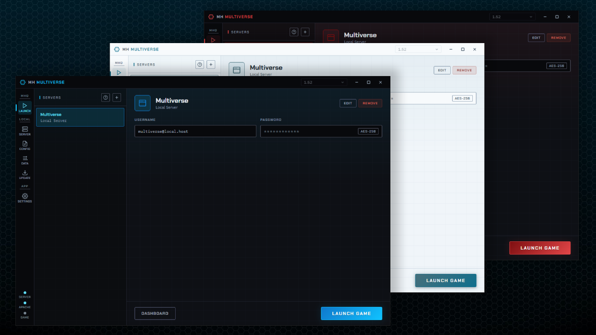
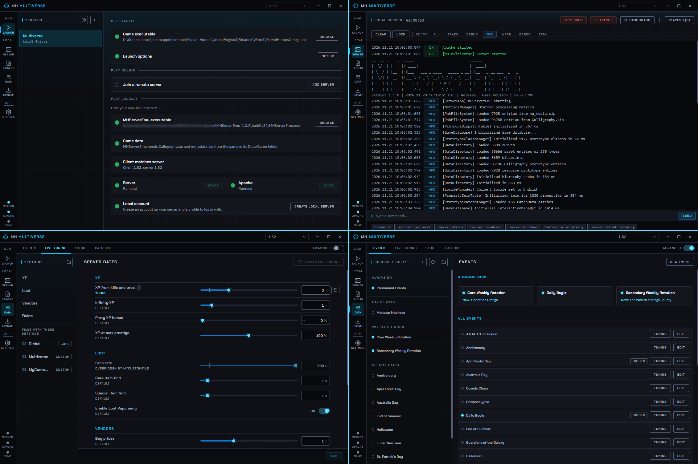

# MH Multiverse

A desktop launcher and server management tool for [MHServerEmu](https://github.com/Crypto137/MHServerEmu), the Marvel Heroes Omega server emulator. Built with Tauri 2, Svelte 5, and Rust.

---

## Overview

MH Multiverse provides a single interface for launching Marvel Heroes Omega, managing a local MHServerEmu instance, and editing the server's data files. It handles process lifecycle, profile management, config editing, live tuning, data patching, MTX store catalog editing, server updates, and backups.

The app is currently Windows-only and communicates with the server via stdin/stdout piping and direct file I/O against MHServerEmu's data directories.

---

## Features

### Game Launching
- Multi-server profile management with optional auto-login
- Steam or standalone launch, plus common launch options and your own arguments
- A Get Started checklist on the Launch page that walks through linking the game and MHServerEmu and adding your first server
- Link several game versions (1.48, 1.52, 1.53 and Custom server builds) and switch between them from the title bar, or have your server profiles automatically switch
- Account import and restore from in-game `!account download` backups

### Local Server Management
- Start and stop MHServerEmu with a live console and command autocomplete
- Configure shutdown delays, Apache control, and a player list with kick, ban, whitelist and user level

### Server Config
- Visual editor for `Config.ini` / `ConfigOverride.ini` with grouped sections, tooltips, and type-appropriate controls

### Data Tab
- Simple views for Events, Server Rates (Live Tuning), the Store and Patches with Game Tweaks
- Advanced editors for Events, Live Tuning, Store and Data Patching
  - MH Multiverse reads `Calligraphy.sip` to get the definitions for items, powers, regions, and other game data - so searches in these editors can find things by name instead of numeric IDs
- Automatic `.bak` snapshots before every write

### Updates and Backups
- One-click MHServerEmu nightly updates with backup and restore, and in-app updates for MH Multiverse
- On-demand manual backups of the server's config and data

### Settings and Integrations
- Eight themes, and adjustable text size/zoom
- MarvelHeroes Overlay: link and trust your copy, optionally inject on launch, toggle its flags, and view the loot-filter log from within Multiverse
- Import existing profiles from Bifrost and the Overlay

---




---

## Installation

### Prerequisites

**Running the release (`.exe` / `.msi`)**
- Windows 10 or 11
- [Microsoft Edge WebView2 runtime](https://developer.microsoft.com/microsoft-edge/webview2/) (preinstalled on Windows 11 and most up-to-date Windows 10 installs. The `.msi`/installer will fetch it if missing)

**Building from source**
- Everything above
- [Node.js](https://nodejs.org/) (LTS)
- [Rust](https://rustup.rs/) (stable, 1.77.2+)
- [Tauri CLI](https://v2.tauri.app/start/prerequisites/) prerequisites for your platform (on Windows: Microsoft C++ Build Tools)

If you just want to run MH Multiverse, grab the `.exe` or `.msi` from the [Releases page](https://github.com/cackl/mh-multiverse/releases) and skip the rest of this section.
The "About" page in-app - found under "Settings" - checks for updates, so as long as you have release 1.4.0 or newer you can also update that way.

### Setup
```cmd
npm install
```

### Development
```cmd
npm run tauri dev
```

### Build
```cmd
npm run tauri build
```
The standalone executable is written to `src-tauri\target\release\mh-multiverse.exe`. Installers are in `src-tauri\target\release\bundle\`.

### Cleanup
While the executable itself is small, `tauri dev` and `tauri build` generate a lot of temporary dependencies and build artifacts in `src-tauri\target` (in the multiple gigabyte range). Once you've copied the executable somewhere else, you can reclaim that space with:
```cmd
cd src-tauri
cargo clean
```

### Uninstall
If you used the installer or `.msi`, remove **MH Multiverse** via Windows *Settings > Apps > Installed apps*. If you're running the standalone `.exe`, just delete it.

Neither method removes your settings (like server lists). To fully clean up, also delete these folders:
```
%APPDATA%\com.mhmultiverse.app        (app settings in multiverse.json, window position and size)
%LOCALAPPDATA%\com.mhmultiverse.app   (WebView2 cache)
```

### NOTE
*MH Multiverse is an unsigned executable that starts other processes (e.g Marvel Heroes Omega, MHServerEmu) and creates, writes and reads files (e.g ConfigOverride.ini, Data Patching, Live Tuning). Like Bifrost, this may cause false positive detections from antivirus software. Updates delivered through the in-app updater are verified with a minisign signature, but this is separate from Windows code signing, so the executable itself is still unsigned. If this causes issues, with the prerequisites installed the source code can be built with just two commands.*

---

## Good to Know
- While MH Multiverse encrypts has OS-keychain-backed encryption of passwords, with auto-login on the game client still writes your password in plain text to its own Launch.log
- 1.48 and 1.53 clients always launch standalone, and MH Multiverse only injects the Overlay to 1.52 clients
- Custom server builds don't get nightly updates
- A backup target always wins over the nightly's copy, so upstream fixes to those files don't arrive until you remove the target

---

## Planned Updates

Some items I'm looking at next:
- A safer auto-login or other strategies that keep passwords out of the game client's log
- More plain-language help for MHServerEmu settings and friendlier editors for the remaining Data settings
- Further fixes and polish

**Not yet planned: Linux support.** MH Multiverse depends on Windows-specific process handling (Job Objects, DLL injection for the Overlay integration) and I'm not yet set up to test it properly, so it isn't planned in the near term. If that changes, it'll be announced here.

---

## Acknowledgements

A special thanks to all contributors of the [MHServerEmu](https://github.com/Crypto137/MHServerEmu) project for their tireless work in bringing Marvel Heroes Omega back to life.

Additionally, this project was inspired by the great work done in the following projects
- Crypto137: [Bifrost](https://github.com/Crypto137/Bifrost)
- Crypto137: [MHServerEmu.Gui](https://github.com/Crypto137/MHServerEmu.Gui)
- Crypto137: [OpenCalligraphy](https://github.com/Crypto137/OpenCalligraphy)
- mtzimas92: [MHServerEmu-CatalogManager](https://github.com/mtzimas92/MHServerEmu-CatalogManager)
- Pyrox37: [MHServerEmuUI](https://github.com/Pyrox37/MHServerEmuUI)
