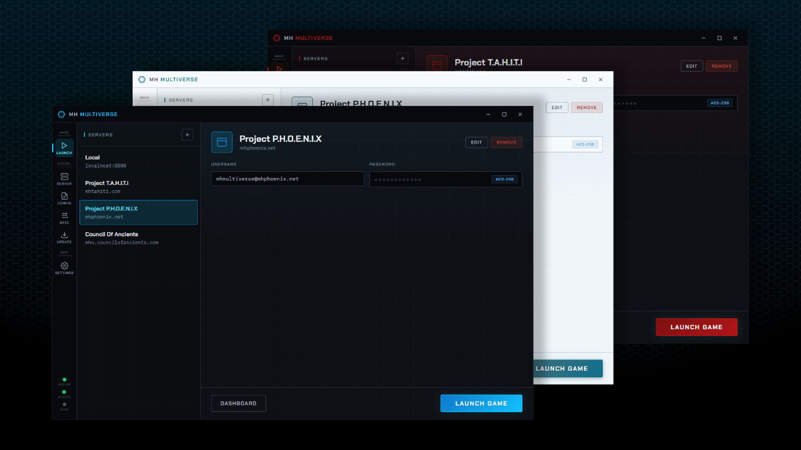
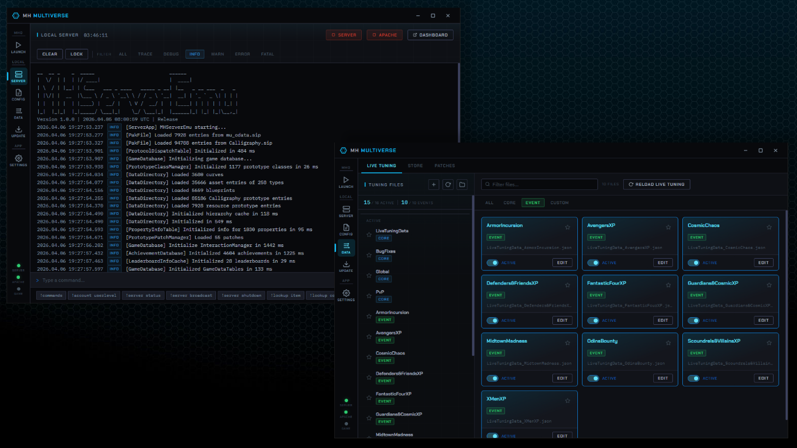

# MH Multiverse

A desktop launcher and server management tool for [MHServerEmu](https://github.com/Crypto137/MHServerEmu), the Marvel Heroes Omega server emulator. Built with Tauri 2, Svelte 5, and Rust.

---

## Overview

MH Multiverse provides a single interface for launching Marvel Heroes Omega, managing a local MHServerEmu instance, and editing the server's data files. It handles process lifecycle, profile management, config editing, live tuning, data patching, MTX store catalog editing, server updates, and backups.

The app is currently Windows-only and communicates with the server via stdin/stdout piping and direct file I/O against MHServerEmu's data directories.

---

## Features

### Game Launching
- Multi-server profile management with encrypted, OS-keychain-backed credentials and optional auto-login (note: the game client writes the password in plain text to its own Launch.log). Local profiles support both patched and unpatched clients
- Steam Mode for Steam copies (`-steam -nosolidstate`), otherwise standalone (`-robocopy -nosteam`)
- Launch options: skip startup movies/motion comics, no sound, custom resolution, client log, 32-bit client, patched client, plus an Additional Arguments field
- A Get Started checklist on the Launch page that walks through linking the game and MHServerEmu and adding a server
- Add Server with Remote, Local and From Backup tabs. On a local server that uses SQLite persistence, saving a profile creates the account on the server in the same step
- Account import and restore from `!account download` JSON backups, for servers that store data in either SQLite or the single JSON file

### Local Server Management
- Start/stop MHServerEmu with live log streaming and an interactive, autocomplete-backed command console
- View logged-in players with moderation shortcuts (user level, kick, ban, whitelist)
- Apache start/stop independent of MHServerEmu to allow for the use of alternate web servers

### Server Configuration (INI Editor)
- Visual editor for `Config.ini` / `ConfigOverride.ini` with grouped sections, tooltips, and type-appropriate controls
- Diff-only saving (only non-default values are written) with per-section reset

### Events & Live Tuning Editor
- Scan, create, edit, and toggle Events and `LiveTuningData*.json` files, with settings autocomplete and prototype path search
- Attach tuning files to event schedules to customise event rotations
- Tag-based organisation (Core, Event, Custom) with favourites

### Store Catalog Editor
- Load, create, edit, and delete `Catalog*.json` entries, with type/modifier assignment matching MHServerEmu's catalog system
- Non-destructive editing to `*MODIFIED.json` sidecars, with automatic `.bak` snapshots before every write
- Prototype item picker with display name resolution, and bundle HTML generation for the in-game store

### Data Patching Editor
- Scan, create, edit, and toggle `PatchData*.json` files, enabled/disabled via moves to `Patches/` / `Patches/Off/`
- Per-entry field path, value type, and value editing, with matching prototype and value-type pickers

### Server Updates & Backups
- One-click updates from MHServerEmu nightly builds, with automatic backup before and restore of modified files after
- Configurable backup targets, plus manual backup creation, restore, and deletion with manifest tracking

### Application Settings
- Game/server executable path configuration with file browser, and multiple app themes

### Integrations
- MarvelHeroes Overlay: link and trust your copy, optionally inject on launch, toggle its flags, and view the loot-filter log
- Import Server Profiles from Bifrost and the overlay launcher, with a preview before saving
- `Calligraphy.sip`: Reads the game's data file (`Calligraphy.sip`) to know the definitions for items, powers, regions, and other objects - powering searches in Live Tuning, Data Patching and Store Catalog editors to find things by name instead of numeric IDs




---

## Installation

### Prerequisites

**Running the release (`.exe` / `.msi`)**
- Windows 10 or 11
- [Microsoft Edge WebView2 runtime](https://developer.microsoft.com/microsoft-edge/webview2/) (preinstalled on Windows 11 and most up-to-date Windows 10 installs; the `.msi`/installer will fetch it if missing)

**Building from source**
- Everything above
- [Node.js](https://nodejs.org/) (LTS)
- [Rust](https://rustup.rs/) (stable, 1.77.2+)
- [Tauri CLI](https://v2.tauri.app/start/prerequisites/) prerequisites for your platform (on Windows: Microsoft C++ Build Tools)

If you just want to run MH Multiverse, grab the `.exe` or `.msi` from the [Releases page](https://github.com/cackl/mh-multiverse/releases) and skip the rest of this section.
The "About" page in-app - found under "Settings" - checks for updates, so as long as you have release 1.4.0 or newer you can also update that way.

### Setup
```cmd
npm install
```

### Development
```cmd
npm run tauri dev
```

### Build
```cmd
npm run tauri build
```
The standalone executable is written to `src-tauri\target\release\mh-multiverse.exe`. Installers are in `src-tauri\target\release\bundle\`.

### Cleanup
While the executable itself is small, `tauri dev` and `tauri build` generate a lot of temporary dependencies and build artifacts in `src-tauri\target` (in the multiple gigabyte range). Once you've copied the executable somewhere else, you can reclaim that space with:
```cmd
cd src-tauri
cargo clean
```

### Uninstall
If you used the installer or `.msi`, remove **MH Multiverse** via Windows *Settings > Apps > Installed apps*. If you're running the standalone `.exe`, just delete it.

Neither method removes your settings (like server lists). To fully clean up, also delete these folders:
```
%APPDATA%\com.mhmultiverse.app        (app settings in multiverse.json, window position and size)
%LOCALAPPDATA%\com.mhmultiverse.app   (WebView2 cache)
```

### NOTE
*MH Multiverse is an unsigned executable that starts other processes (e.g Marvel Heroes Omega, MHServerEmu) and creates, writes and reads files (e.g ConfigOverride.ini, Data Patching, Live Tuning). Like Bifrost, this may cause false positive detections from antivirus software. Updates delivered through the in-app updater are verified with a minisign signature, but this is separate from Windows code signing, so the executable itself is still unsigned. If this causes issues, with the prerequisites installed the source code can be built with just two commands.*

---

## Planned Updates

Next up for 1.7.0: continuing the streamlining and abstraction principles from the Get Started checklist taken to the Data tab. I'm aiming to make configuring Events, Live Tuning, Store Catalogs, and Data Patching accessible to more users.

---

## Acknowledgements

A special thanks to all contributors of the [MHServerEmu](https://github.com/Crypto137/MHServerEmu) project for their tireless work in bringing Marvel Heroes Omega back to life.

Additionally, this project was inspired by the great work done in the following projects
- Crypto137: [Bifrost](https://github.com/Crypto137/Bifrost)
- Crypto137: [MHServerEmu.Gui](https://github.com/Crypto137/MHServerEmu.Gui)
- Crypto137: [OpenCalligraphy](https://github.com/Crypto137/OpenCalligraphy)
- mtzimas92: [MHServerEmu-CatalogManager](https://github.com/mtzimas92/MHServerEmu-CatalogManager)
- Pyrox37: [MHServerEmuUI](https://github.com/Pyrox37/MHServerEmuUI)
